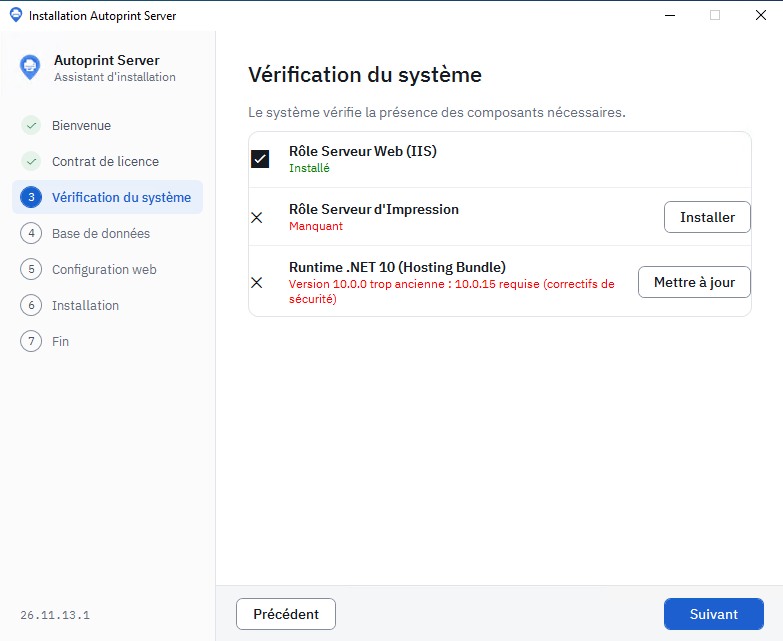
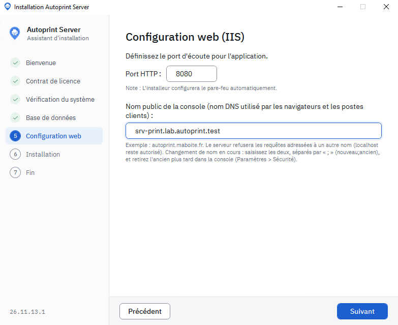

# Installer le serveur Autoprint

Ce guide installe le serveur Autoprint : la console d'administration web, l'API utilisée par les postes et le service qui pilote le spouleur d'impression Windows.

Durée : environ 20 minutes, certificat HTTPS compris.

## Avant de commencer

| Élément | Exigence |
|---|---|
| Système | Windows Server 2019, 2022 ou 2025, 64 bits, de préférence en français. Le serveur peut être membre d'un domaine Active Directory, ce qui est nécessaire pour la connexion des comptes AD. |
| Rôles Windows | Serveur Web (IIS) et Serveur d'impression. L'installeur les ajoute s'ils manquent. |
| Runtime .NET | ASP.NET Core 10 (Hosting Bundle). L'installeur l'embarque et l'installe s'il manque. |
| Base de données | SQLite (un fichier, rien à installer) ou SQL Server 2019 ou plus récent, sur ce serveur ou sur un autre. |
| Nom DNS | Un nom pour la console, par exemple `autoprint.mondomaine.fr`, qui pointe vers ce serveur. |
| Certificat | Un certificat HTTPS pour ce nom, **approuvé par les postes** : autorité publique ou autorité de certification interne. Le client Autoprint refuse un certificat auto-signé. |
| Droits | Un compte administrateur local du serveur. |

**SQLite ou SQL Server ?** SQLite suffit pour un serveur unique et quelques centaines de postes, sans rien à administrer. Choisissez SQL Server si vous en avez déjà un et que vous voulez profiter de ses sauvegardes.

Téléchargez la dernière version sur la page [Releases](https://github.com/vindbrann/Autoprint/releases) du projet : `Autoprint-Serveur-Installation-<version>.exe`.

## 1. Lancer l'installeur

Lancez `Autoprint-Serveur-Installation-<version>.exe` en tant qu'administrateur. L'assistant compte sept étapes.

1. **Bienvenue.**
2. **Contrat de licence** : la licence MIT. Cochez « J'accepte les termes du contrat de licence ».
3. **Vérification du système** : IIS, le rôle Serveur d'impression et le runtime .NET 10 sont contrôlés. Pour un élément manquant, cliquez sur **Installer** en face ; pour un runtime trop ancien, sur **Mettre à jour**. Attendez ensuite qu'il passe au vert.

   

4. **Base de données** :
   - **SQLite** : rien à saisir. La base est créée dans `C:\ProgramData\Autoprint\Data`.
   - **SQL Server** : saisissez le serveur (`sqlsrv01` ou `sqlsrv01\SQLEXPRESS`), le port s'il n'est pas standard, le nom de la base (`AutoprintDb` par défaut) et le mode d'authentification. Cliquez sur **Tester la connexion** avant de continuer. La base est créée si elle n'existe pas.
5. **Configuration web (IIS)** :
   - **Port HTTP** : `8080` par défaut. L'installeur ouvre ce port dans le pare-feu.
   - **Nom public de la console** : le nom DNS que les navigateurs et les postes utiliseront, par exemple `autoprint.mondomaine.fr`. Pour accepter plusieurs noms, séparez-les par `;`, le principal en premier.

   

6. **Installation** : copie des fichiers, création du site et du pool IIS, du service d'impression et de la base.
7. **Installation terminée.**

> Pour **mettre à jour** un serveur existant, lancez simplement l'installeur de la nouvelle version : il reconnaît l'installation et garde la base et les réglages. Voir [Mettre à jour Autoprint](mise-a-jour.md).

## 2. Activer HTTPS

Les postes clients ne se connectent qu'en HTTPS, avec un certificat qu'ils approuvent.

1. Importez le certificat (`.pfx`) dans le magasin **Ordinateur local > Personnel** du serveur.
2. Ouvrez le **Gestionnaire des services Internet (IIS)**, puis le site **Autoprint**, puis **Liaisons…**.
3. Ajoutez une liaison **https**, port **443**, avec le nom d'hôte de la console. Cochez **Exiger l'indication du nom du serveur (SNI)** et choisissez le certificat.
4. Vérifiez depuis un poste : `https://autoprint.mondomaine.fr/` s'ouvre sans alerte de certificat.

Une fois HTTPS en place, Autoprint redirige automatiquement les connexions HTTP vers HTTPS. La liaison HTTP 8080 peut rester ; elle ne sert plus qu'à rediriger.

## 3. Première connexion

1. Ouvrez `https://autoprint.mondomaine.fr/`. Depuis le serveur lui-même, `https://localhost/` fonctionne aussi.
2. Connectez-vous avec le compte de départ **`admin`**, mot de passe **`admin123`**.
3. Autoprint vous demande aussitôt un nouveau mot de passe : au moins 12 caractères, différent de l'identifiant.

Ce compte local reste le compte de secours, utile si l'annuaire Active Directory est injoignable. Gardez son mot de passe en lieu sûr.

## 4. Réglages de départ

Dans **Paramètres** :

1. **Sécurité > Noms acceptés par le serveur** : vérifiez que le nom public y figure. Le serveur refuse tout autre nom (erreur 400), sauf `localhost`.
2. **Active Directory** : le domaine, un compte de service pour les recherches, puis les groupes AD autorisés et le rôle de chacun. Le bouton **Vérifier un compte** montre ce qu'obtiendrait un utilisateur donné.
3. **Messagerie (SMTP)** : le serveur d'envoi, puis **Envoyer un e-mail de test**. Il sert aux alertes, aux rapports et aux liens « mot de passe oublié ».
4. **Maintenance** : faites une première **sauvegarde avec un mot de passe de protection** et rangez le fichier à part. C'est elle qui permet de reconstruire le serveur sur une autre machine (voir le [guide administrateur](guide-administrateur.md#sauvegarde-et-restauration)).
5. **Sécurité > Clé d'API des postes clients** : copiez la clé. Elle sera demandée pour déployer le client.

## Et ensuite

- Déclarer vos lieux et vos imprimantes : [Premiers pas](premiers-pas.md).
- Installer le client sur les postes : [Déployer le client](deploiement-client.md).
