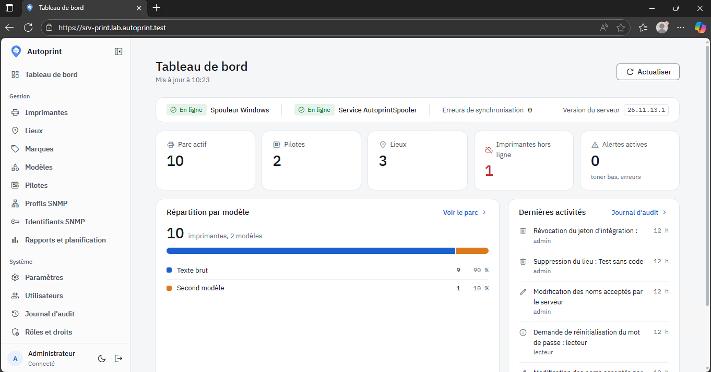
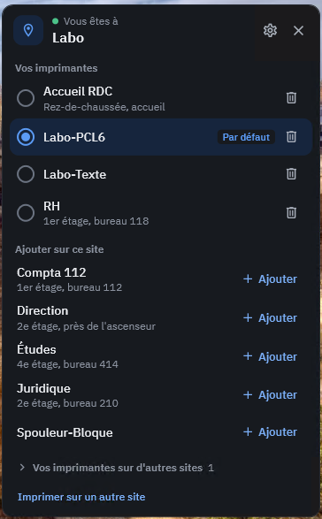
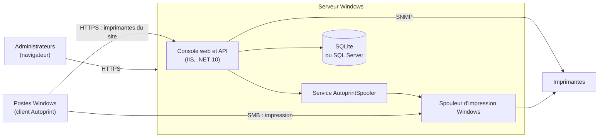

# Autoprint

**Les bonnes imprimantes, au bon endroit, sans ticket au support.**

Autoprint gère le parc d'imprimantes d'une organisation multi-sites depuis une console web. Sur chaque poste, un petit client détecte le site où se trouve l'utilisateur et lui propose les imprimantes de ce site.

[](https://github.com/vindbrann/Autoprint/releases)
[](LICENSE)
[](https://dotnet.microsoft.com/)

<p align="center">
  
  &nbsp;
  
</p>

## Ce que fait Autoprint

- **Les imprimantes suivent l'utilisateur.** Le client reconnaît le site à partir de l'adresse IP du poste, propose les imprimantes du site et rétablit l'imprimante par défaut choisie pour ce site. C'est fait pour les portables qui passent d'un bâtiment à l'autre.
- **Le serveur d'impression Windows se configure tout seul.** Vous décrivez le parc dans la console ; Autoprint crée les ports, les files et les partages, avec un aperçu avant chaque changement. L'impression directe est possible pour les sites distants.
- **Le parc est supervisé.** Autoprint lit l'état, les toners, les bacs et les compteurs en SNMP (v2c et v3), prévoit l'épuisement des toners et envoie des rapports PDF ou CSV par e-mail.
- **L'administration est déléguée en sécurité.** Comptes Active Directory par groupe, rôles et droits fins, journal d'audit complet, secrets chiffrés.
- **Il s'intègre à l'existant.** Le client se déploie par Intune ou tout outil qui sait installer un MSI, et Autoprint expose un export pour Zabbix, PRTG, Centreon…

## Comment ça marche



## Prérequis

| | |
|---|---|
| **Serveur** | Windows Server 2019, 2022 ou 2025, avec IIS et le rôle Serveur d'impression (l'installeur s'en charge) |
| **Base** | SQLite (rien à installer) ou SQL Server |
| **Postes** | Windows 10 ou 11, 64 bits, gérés par Intune ou non |
| **Réseau** | Un nom DNS et un certificat HTTPS approuvé par les postes |

## Installation

1. Téléchargez l'installeur serveur et le MSI client sur la page [Releases](https://github.com/vindbrann/Autoprint/releases).
2. Installez le serveur et activez HTTPS : [Installer le serveur](Docs/guides/installation-serveur.md).
3. Déclarez vos lieux, modèles et imprimantes : [Premiers pas](Docs/guides/premiers-pas.md).
4. Déployez le client sur les postes : [Déployer le client](Docs/guides/deploiement-client.md).
5. Montrez le panneau aux utilisateurs : [Guide utilisateur](Docs/guides/guide-utilisateur.md).

## Documentation

| Guide | Pour |
|---|---|
| [Installer le serveur](Docs/guides/installation-serveur.md) | Installation, HTTPS, première connexion, réglages de départ |
| [Premiers pas](Docs/guides/premiers-pas.md) | De zéro à la première imprimante proposée aux postes |
| [Déployer le client](Docs/guides/deploiement-client.md) | Paramètres du MSI, Intune, pilotes sur les postes |
| [Guide administrateur](Docs/guides/guide-administrateur.md) | Toute la console : parc, supervision, rapports, droits, paramètres, sauvegarde |
| [Guide utilisateur](Docs/guides/guide-utilisateur.md) | Le panneau Autoprint sur le poste |
| [Mettre à jour](Docs/guides/mise-a-jour.md) | Serveur puis postes, y compris depuis la 1.1.x |
| [Changer l'adresse de la console](Docs/guides/migration-changement-de-nom.md) | Migration sans couper les postes |
| [Dépannage](Docs/guides/depannage.md) | Problèmes courants et emplacements utiles |

Pour les développeurs : [serveur](Docs/technique/DOC_Server.md), [client](Docs/technique/DOC_Client.md), [modèle de sécurité](Docs/technique/securite.md), [carte du projet](Docs/projet/PROJECT_MAP.md).

Les nouveautés de chaque version sont dans le [CHANGELOG](CHANGELOG.md).

## Développer

Il faut Windows, le SDK .NET 10 et un éditeur compatible .NET 10 (Visual Studio, Rider ou VS Code). Les installeurs se compilent avec WiX 7, récupéré automatiquement par NuGet.

```bash
dotnet build Autoprint.sln -c Release
```

| Projet | Rôle |
|---|---|
| `Autoprint.Server` | API, hôte de la console, supervision, rapports |
| `Autoprint.Web` | Console d'administration (Blazor WebAssembly, Radzen) |
| `Autoprint.Shared` | Modèles et DTO communs |
| `Autoprint.SpoolerService` | Service Windows qui pilote le spouleur |
| `Autoprint.Client` | Client des postes (WPF) |
| `Autoprint.Installer.Server.UI`, `*.Setup` | Installeur serveur et MSI |

Pour lancer la console en local sans serveur d'impression, utilisez une base SQLite jetable : variables `Database__Provider=Sqlite`, `Database__ConnectionStrings__Sqlite` et `DataProtection__KeysPath`. Le compte de départ est `admin` / `admin123`, à changer à la première connexion.

Le dossier [`tools/lab`](tools/lab/README.md) décrit le labo de test (Hyper-V, domaine, simulateur SNMP) et les tests automatisés de l'API. La feuille de route et les points ouverts sont dans le [backlog](Docs/projet/BACKLOG_AMELIORATIONS.md).

## Sécurité

Pour signaler une faille, n'ouvrez pas d'*issue* publique : suivez [SECURITY.md](SECURITY.md).

## Licence

[MIT](LICENSE). Copyright (c) 2025-2026 Nicolas CARUANA. Autoprint embarque des composants tiers sous leurs propres licences, listés dans [THIRD-PARTY-NOTICES.txt](THIRD-PARTY-NOTICES.txt).
